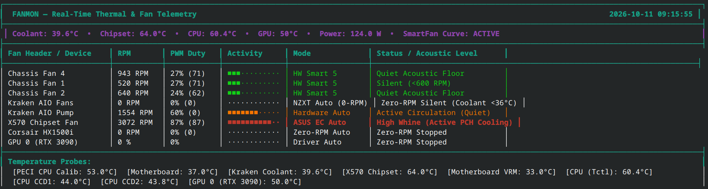

# fanmon

Real-time hardware thermal & fan telemetry monitor for Linux workstations. A
curses TUI that reads `/sys/class/hwmon`, `nvidia-smi`, and systemd state and
renders a single high-density screen: per-fan RPM/PWM/activity bars, mode
pills, acoustic status labels, and a temperature probe strip.

Built for an AMD/X570 desktop with a Nuvoton NCT6798 Super I/O, NZXT Kraken
AIO, ASUS EC chipset sensor, `k10temp` CPU temps, a Corsair digital PSU, and
NVIDIA GPU — but every source is discovered dynamically, so missing
components simply don't show up.



## Features

- **One screen, no scrolling** — box-drawn table with per-fan activity bars,
  color-coded by load, plus a telemetry pill bar (CPU / Coolant / Chipset /
  GPU temps, PSU draw, curve-service status).
- **Dynamic hwmon discovery** — finds `nct*`, `kraken*`, `asusec`, `k10temp`,
  `corsairpsu` hwmon chips at runtime (5 s re-discovery cadence); no
  hardcoded device paths.
- **Multiple output modes**
  - `fanmon` — interactive curses TUI (1 s default refresh)
  - `fanmon --once` — single plain-text snapshot (scriptable)
- **TUI keys**: `q` quit, `r` refresh, `p`/space pause, `+/=` faster, `-/`
  slower, `c` re-apply fan curves (re-runs the installed
  `/usr/local/sbin/apply-fan-curves.sh`).
- **Acoustic status labels** — RPM bands map to human-readable states
  (Silent, Quiet Acoustic Floor, Moderate Ramp, High Load Ramp, Zero-RPM
  Silent, High Whine for PCH fans, …).

## Repo layout

```
fanmon                     # main TUI / CLI monitor (python3, stdlib only)
scripts/
  apply-fan-curves.sh      # one-shot: writes NCT6798 hardware SmartFan IV curves
  chipset-fan-monitor.py   # daemon: dynamic X570 chipset-fan PWM control +
                           #   case-fan thermal flush when PCH ramps
systemd/
  fan-hardware-curves.service    # oneshot, runs apply-fan-curves.sh early boot
  chipset-fan-monitor.service    # always-restart daemon for chipset control
docs/fanmon01.png            # TUI screenshot
```

## Installation

### 1. Monitor (any Linux desktop)

```sh
git clone <this repo>
sudo install -m 755 fanmon /usr/local/bin/fanmon
fanmon            # TUI
fanmon --once     # one-shot snapshot
```

No dependencies beyond Python 3 stdlib (`curses`). `nvidia-smi` and the
`fan-hardware-curves.service` systemd unit are optional — they simply won't
appear if absent.

### 2. Fan curve control (ASUS X570 + NCT6798 example)

The scripts in `scripts/` are tuned for the specific build this was written
on (NCT6798 PWM1 = rear, PWM3 = front intake, PWM4 = X570 aux, PWM2
unpopulated; `asusec` for the PCH fan; Kraken 2023 AIO). Adapt the PWM
values, header assignments, and temperature breakpoints to your board before
enabling.

```sh
sudo install -m 755 scripts/apply-fan-curves.sh /usr/local/sbin/
sudo install -m 755 scripts/chipset-fan-monitor.py /usr/local/sbin/
sudo install -m 644 systemd/fan-hardware-curves.service /etc/systemd/system/
sudo install -m 644 systemd/chipset-fan-monitor.service /etc/systemd/system/
sudo systemctl daemon-reload
sudo systemctl enable --now fan-hardware-curves.service
sudo systemctl enable --now chipset-fan-monitor.service
```

The TUI's `c` key re-applies the curves by invoking the **installed**
`/usr/local/sbin/apply-fan-curves.sh` (absolute path), not the copy in this
repo checkout. So install the script to `/usr/local/sbin/` first — the `c`
key and the `fan-hardware-curves` boot unit both target that location — then
run the TUI from anywhere (repo checkout, `/usr/local/bin`, or elsewhere).
If `/usr/local/sbin/apply-fan-curves.sh` is not installed, `c` is a silent
no-op so the TUI never crashes on a missing path.

### Curve summary (as shipped)

| Header | Control | Behavior |
|---|---|---|
| PWM1 — CHA_FAN1 (rear) | HW SmartFan IV | CPU PECI-tracked: 45 °C → 27 % … 75 °C → 80 % (PWM 204 cap), 85 °C → 100 % failsafe |
| PWM2 — CPU_FAN (unpopulated) | Off | Header removed from aux cooling; left off (fan2 tach may read phantom RPM) |
| PWM3 — CHA_FAN2 (front intake) | HW SmartFan IV | Same curve as PWM1 |
| PWM4 — CHA_FAN3 (X570 aux, 2 serial fans) | Manual (daemon) | 70 % floor ≤ 55 °C, ramps 70 → 95 % to 70 °C PCH, 100 % above |
| Kraken pump/fan | NZXT hardware auto | 0-RPM mode below ~36 °C coolant |

When the PCH fan RPM exceeds ~80 % (≈ 2800 RPM), `chipset-fan-monitor.py`
temporarily takes manual control of PWM1/PWM3 and boosts them in lockstep
with a CPU-temperature floor, then hands control back to the hardware
curves when the PCH cools.

## Notes

- All reads are wrapped in safe readers: a missing sensor or unreadable
  hwmon file degrades to zero/blank instead of crashing.
- The TUI clamps to a 120-column box and gracefully handles small terminals.
- `--once` output uses the same layout, handy for cron logging or
  screenshots.
